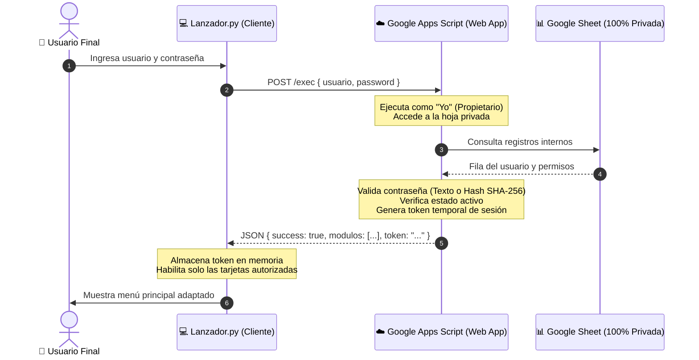

# 🚀 Guía Paso a Paso: Autenticación Segura con Google Apps Script y Lanzador Modular

Este documento detalla el paso a paso para configurar la arquitectura de **seguridad total** para el sistema del Lanzador. 

---

## 🛡️ ¿Por qué esta Nueva Arquitectura de Seguridad?

| Flujo Anterior (Inseguro) | Flujo Nuevo con Apps Script (100% Seguro) |
| :--- | :--- |
| ❌ La hoja de Google Sheets debía compartirse como pública o "Cualquiera con el enlace". | ✅ **La hoja es 100% PRIVADA** (Acceso: Solo tú / Restringido). |
| ❌ El cliente descargaba el CSV completo con todos los usuarios y contraseñas. | ✅ **Cero descarga de datos:** El cliente solo envía usuario y contraseña. |
| ❌ El ID del Google Sheet quedaba expuesto en `config.json`. | ✅ **Cero exposición:** El cliente solo conoce la URL de la Web App (`/exec`). |
| ❌ Cualquier usuario podía abrir la hoja de cálculo en su navegador. | ✅ **Los usuarios finales no tienen permisos** en Google Drive ni en la hoja. |
| ❌ Contraseñas en texto plano leídas directamente en el PC. | ✅ **Soporta validación de contraseñas con Hash SHA-256** y tokens de sesión. |



---

## 📋 PASO 1: Configurar la Hoja de Google Sheets Privada

1. Abre tu hoja de cálculo en Google Drive.
2. Asegúrate de que la hoja sea **completamente privada**:
   - Haz clic en el botón verde **Compartir** (arriba a la derecha).
   - En **Acceso general**, asegúrate de que esté configurado como **Restringido** (Solo las personas con acceso pueden abrir este enlace).
   - **No agregues a los usuarios finales aquí.**
3. En la hoja, crea o renombra la pestaña principal a: **`Usuarios`**.
4. Define los siguientes encabezados en la **Fila 1**:

| Columna A | Columna B | Columna C | Columna D |
| :--- | :--- | :--- | :--- |
| **Usuario** | **Password** | **Modulos** | **Estado** |

### Ejemplo de Registros:

| Usuario | Password | Modulos | Estado |
| :--- | :--- | :--- | :--- |
| **admin** | `Admin2026*` *(o Hash)* | `*` | `Activo` |
| **juan.perez** | `ClaveSegura1` | `PDF_Unir, Gene_Documentos` | `Activo` |
| **marta.lopez** | `ClaveMarta` | `PDF_Unir` | `Activo` |
| **carlos.ruiz** | `ClaveCarlos` | `Gene_Documentos` | `Activo` |
| **demo.bloqueado**| `Demo1234` | `PDF_Unir` | `Inactivo` |

> [!TIP]
> **¿Deseas almacenar contraseñas cifradas con Hash SHA-256 en lugar de texto plano?**  
> El script incluye la función `=SHA256("tu_clave")`. En Google Sheets puedes escribir por ejemplo `=SHA256("Admin2026*")` en la celda de la contraseña. El backend reconoce automáticamente si la contraseña almacenada es un Hash o texto plano.

---

## ☁️ PASO 2: Crear e Implementar la Web App en Google Apps Script

El código completo y listo para usar se encuentra en el archivo [`GoogleAppsScript_Code.gs`](file:///d:/CR-SISTEMAS-99o/Documents/ProgramasAntig/Lanzandor/GoogleAppsScript_Code.gs).

### 2.1 Pegar el Código en Apps Script
1. En tu hoja de cálculo de Google Sheets, ve al menú superior:
   👉 **Extensiones** > **Apps Script**.
2. Se abrirá el editor de Apps Script. Borra cualquier código que aparezca por defecto en el archivo `Código.gs`.
3. Abre el archivo local [`GoogleAppsScript_Code.gs`](file:///d:/CR-SISTEMAS-99o/Documents/ProgramasAntig/Lanzandor/GoogleAppsScript_Code.gs), copia todo su contenido y pégalo en el editor de Apps Script.
4. Haz clic en el icono del **Disquete** (Guardar proyecto) o presiona `Ctrl + S`.
5. *(Opcional)* Asigna un nombre al proyecto arriba a la izquierda, por ejemplo: `Backend_Lanzador`.

---

### 2.2 Desplegar como Aplicación Web (¡Paso Crítico de Configuración!)
1. En la esquina superior derecha de Apps Script, haz clic en el botón azul **Implementar** (o *Deploy*) > **Nueva implementación** (*New deployment*).
2. Haz clic en el icono de **Engranaje** ⚙️ a la izquierda de "Seleccionar tipo" y elige: **Aplicación web** (*Web app*).
3. Configura los campos exactamente de la siguiente manera:
   - **Descripción:** `API Autenticación Lanzador v2`
   - **Ejecutar como:** **`Yo (tu_correo@gmail.com)`**  
     *(⚠️ Muy Importante: Esto permite que el script acceda internamente a tu hoja privada).*
   - **Quién tiene acceso:** **`Cualquier persona`** *(o "Cualquier usuario del dominio" si utilizas Google Workspace corporativo).*  
     *(⚠️ Muy Importante: Esto permite que el cliente Python envíe la solicitud POST sin requerir que los usuarios tengan cuenta con permisos en tu Google Drive).*
4. Haz clic en **Implementar** (*Deploy*).

---

### 2.3 Autorizar Permisos de Google (Solo la primera vez)
1. Google te mostrará una ventana titulada: **Se requiere autorización**.
2. Haz clic en **Revisar permisos** (*Authorize access*).
3. Selecciona tu cuenta de Google.
4. Si aparece el aviso *"Google no ha verificado esta aplicación"*:
   - Haz clic en el enlace pequeño **Configuración avanzada** (*Advanced*).
   - Haz clic en **Ir a Backend_Lanzador (no seguro)** (*Go to Backend_Lanzador*).
5. Haz clic en **Permitir** (*Allow*).

---

### 2.4 Copiar la URL de la Aplicación Web
Una vez completado el despliegue, verás una ventana con la confirmación:
- Copia el enlace que aparece debajo de **URL de la aplicación web** (debe terminar en `/exec`):
  Ejemplo:  
  `https://script.google.com/macros/s/AKfycbxXXXXXXXXXXXXXXXXXXXXXXXXXXXXXXX/exec`

> [!CAUTION]
> **No** copies la URL de la biblioteca ni el ID del despliegue. Debe ser la **URL de la aplicación web** que finaliza en `/exec`.

---

## ⚙️ PASO 3: Configurar el Lanzador con la URL de Apps Script

Tienes dos formas sencillas de configurar la URL en el cliente:

### Opción 1: Mediante el archivo `config.json` (Recomendada para distribuir)
Abre el archivo [`config.json`](file:///d:/CR-SISTEMAS-99o/Documents/ProgramasAntig/Lanzandor/config.json) y pega tu URL en la clave `"apps_script_url"`:

```json
{
  "app_title": "AUTOMATIZACIÓN DE ARCHIVOS",
  "app_subtitle": "Seleccione una opción para continuar",
  "apps_script_url": "https://script.google.com/macros/s/TU_CODIGO_AQUI/exec",
  "modules_repo_url": "https://github.com/GigK1R4/Modulos_Lanzador.git",
  "modules_dir": "Modulos_Lanzador",
  "auto_git_update": true,
  "auto_discover_modules": true,
  "network_timeout": 10
}
```

### Opción 2: Desde la interfaz gráfica del Lanzador
1. Ejecuta [`Lanzador.py`](file:///d:/CR-SISTEMAS-99o/Documents/ProgramasAntig/Lanzandor/Lanzador.py) o [`iniciar_lanzador.bat`](file:///d:/CR-SISTEMAS-99o/Documents/ProgramasAntig/Lanzandor/iniciar_lanzador.bat).
2. En la pantalla de inicio de sesión, haz clic en el icono de engranaje **⚙** ubicado abajo en el pie de página.
3. Pega la URL de tu Web App.
4. Haz clic en **Probar Conexión**:
   - Si todo está correcto, verás un mensaje verde: `✓ Conexión exitosa: API Google Apps Script operativa y respondiendo correctamente.`
5. Haz clic en **Guardar Cambios**.

---

## 🧪 PASO 4: Probar la Autenticación

1. **Prueba con Credenciales Válidas:**
   - Ingresa el usuario `admin` y su contraseña.
   - Pulsa **INGRESAR**.
   - El lanzador validará contra Apps Script, recibirá el token y los módulos autorizados, y te abrirá el panel principal con todas las opciones activas.
2. **Prueba con Contraseña Incorrecta:**
   - Ingresa una contraseña errónea.
   - Apps Script responderá: `Usuario o contraseña incorrectos.` sin revelar información del sistema.
3. **Prueba con Usuario Inactivo:**
   - Si el usuario tiene estado `Inactivo` en la hoja privada, el sistema mostrará: `El usuario está inactivo o suspendido. Contacta al administrador.`

---

## 🔄 PASO 5: Cómo Modificar el Script en Apps Script en el Futuro

Si en algún momento realizas cambios en el código de Google Apps Script:
1. En el editor de Apps Script, guarda los cambios (`Ctrl + S`).
2. Haz clic en **Implementar** > **Gestionar implementaciones** (*Manage deployments*).
3. Haz clic en el icono de **Lápiz** ✏️ (Editar).
4. En el menú desplegable **Versión**, selecciona **Nueva versión**.
5. Haz clic en **Implementar**.

> [!IMPORTANT]
> Google Apps Script requiere crear una **Nueva versión** para que la URL pública `/exec` refleje los cambios de código. Si no creas una nueva versión, la URL seguirá ejecutando el código anterior.

---

## 📁 Resumen de Archivos del Proyecto

- [`GoogleAppsScript_Code.gs`](file:///d:/CR-SISTEMAS-99o/Documents/ProgramasAntig/Lanzandor/GoogleAppsScript_Code.gs): Código del backend seguro para pegar en Google Apps Script.
- [`sheet_auth.py`](file:///d:/CR-SISTEMAS-99o/Documents/ProgramasAntig/Lanzandor/sheet_auth.py): Conector cliente Python que realiza peticiones POST al backend.
- [`Lanzador.py`](file:///d:/CR-SISTEMAS-99o/Documents/ProgramasAntig/Lanzandor/Lanzador.py): Interfaz gráfica moderna (CustomTkinter) con soporte de configuración y prueba de conexión.
- [`config.json`](file:///d:/CR-SISTEMAS-99o/Documents/ProgramasAntig/Lanzandor/config.json): Archivo de configuración central sin enlaces directos a Google Sheets.
- [`git_updater.py`](file:///d:/CR-SISTEMAS-99o/Documents/ProgramasAntig/Lanzandor/git_updater.py): Actualizador de módulos automáticos desde GitHub.
- [`iniciar_lanzador.bat`](file:///d:/CR-SISTEMAS-99o/Documents/ProgramasAntig/Lanzandor/iniciar_lanzador.bat): Acceso directo para ejecutar el lanzador.
